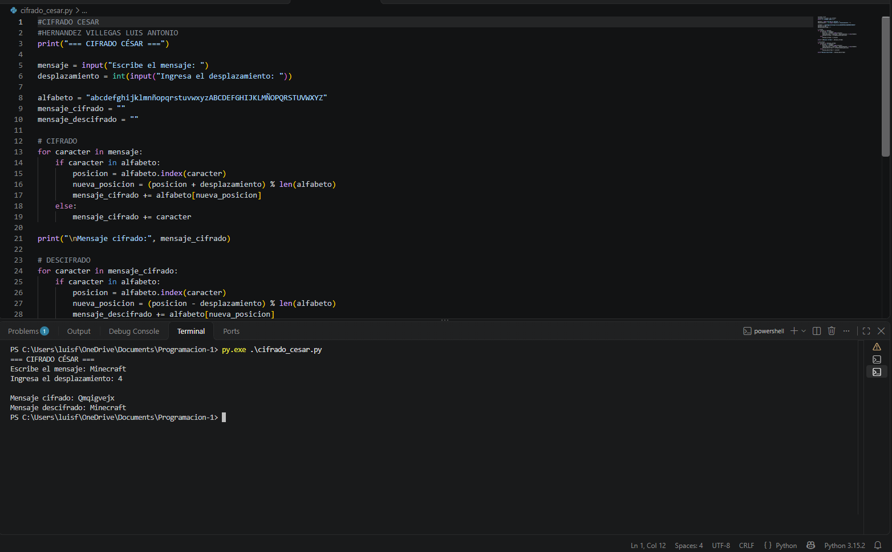

# Programación 1 
Este repositorio contiene los programas y ejercicios desarrollados durante la materia de Programación 1.
Los ejercicios están organizados por temas, y cada
programa se encuentra en su propia carpeta.
## Programas incluidos
### Juego del gato
Juego para dos participantes con un tablero de 3 por 3.
### CURP
Realiza y organiza tus nombres y fecha de nacimiento para formar tu curp
### Frase palindroma
Palabras que son igual aunque esten alreves 
### Cifrado cesar
ingresa un texto y hara un cifrado de x desplazamiento, en el abecedario.
# Requisitos
Tener Python 3 instalado
## Ejecucion
Para ejecutar el programa usa la terminal y escribe por ejemplo "py.exe" o "python3.exe" y el programa que usaras "py.exe .\cifrado_cesar.py" y el programa funcionara correctamente :b

y asi se veria :D
## Autor
Luis Antonio Hernández Villegas
